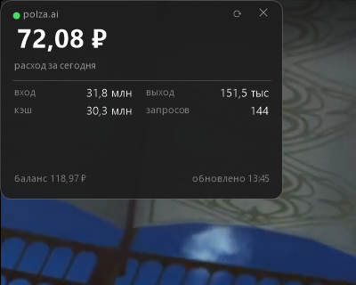

# Polza Widget

Карточка на рабочем столе с расходами за сегодня по [polza.ai](https://polza.ai):
рубли, токены входа и выхода, кэш, число запросов и баланс. Обновляется раз в 30 секунд.



## Что умеет

- показывает расход за текущие сутки и остаток баланса;
- обновляется сама раз в 30 секунд (интервал настраивается);
- помнит, куда вы её перетащили;
- зелёная точка — данные свежие, красная — сеть недоступна;
- живёт в трее: свернуть, вернуть, «поверх всех окон», выход;
- **не появляется в Alt+Tab и на панели задач** — это карточка, а не окно;
- полупрозрачный фон (настраивается), текст остаётся чётким;
- не требует прав администратора и ничего не пишет в реестр.

## Установка

### winget

```powershell
winget install AnimeTankist.PolzaWidget
```

### Вручную

1. Скачайте `PolzaWidget.exe` из [Releases](../../releases).
2. Запустите. При первом запуске попросит API-ключ polza.ai (`pza_...`), его можно
   найти кнопкой «Найти в Chatbox» или взять на [polza.ai/dashboard/api-keys](https://polza.ai/dashboard/api-keys).
3. Там же можно отметить «Запускать при входе» и «Ярлык на рабочем столе».

Права администратора не нужны, в реестр ничего не пишется.

## Требования

- Windows 10 (сборка 1903 и новее) или Windows 11, x64;
- .NET Framework 4.8 — входит в состав системы, доустанавливать не нужно.

На Windows 8.1 и на сборках Windows 10 старше 1809 встроенная версия .NET Framework старше 4.8: там её нужно
поставить один раз вручную — [.NET Framework 4.8](https://dotnet.microsoft.com/download/dotnet-framework/net48).
Если её нет, Windows сама покажет такой диалог при запуске.

## Управление

| Действие | Что делает |
|---|---|
| Перетащить карточку | меняет позицию, она запоминается |
| Кнопка ⟳ | обновить сразу |
| Кнопка ✕ | свернуть в трей |
| Двойной клик | открыть polza.ai/dashboard |
| Значок ₽ в трее | показать/скрыть, поверх всех окон, автозапуск, выход |

## Настройки

`%LOCALAPPDATA%\PolzaWidget\config.json`:

```json
{
  "apiKey": "pza_...",
  "refreshSeconds": 30,
  "topmost": false,
  "opacity": 0.85
}
```

`topmost` переключается и из меню трея — значение сохраняется.
`opacity` — непрозрачность фона карточки: `1.0` плотный, `0.5` заметно просвечивает,
по умолчанию `0.85` (фон полупрозрачный, текст и цифры — плотные).

## Приватность

Приложение обращается только к `polza.ai`: история генераций за сегодня,
баланс и (по двойному клику) страница dashboard в браузере.
Ключ хранится локально в `%LOCALAPPDATA%\PolzaWidget\config.json` и никуда больше не отправляется.

## Удаление

```powershell
PolzaWidget.exe --uninstall
```

Убирает ярлыки и автозапуск. Папку с настройками можно удалить вручную:
`%LOCALAPPDATA%\PolzaWidget`.

## Сборка

```powershell
dotnet build src/PolzaWidget/PolzaWidget.csproj -c Release
```

Готовый файл: `src/PolzaWidget/bin/Release/net48/PolzaWidget.exe` (~40 КБ).
Нужен .NET SDK 8 и Windows для сборки WinForms.

## Лицензия

MIT — см. [LICENSE](LICENSE).
